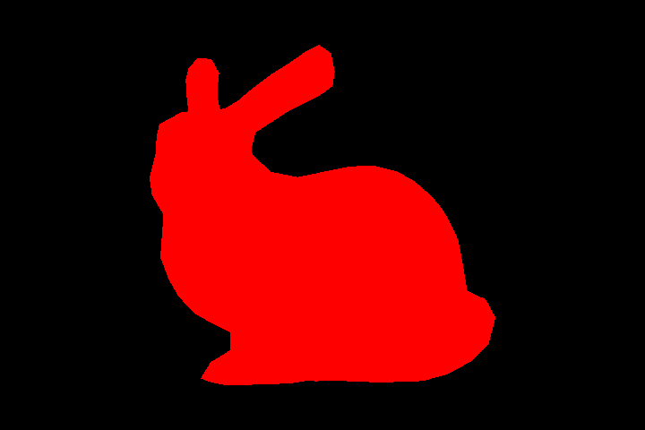
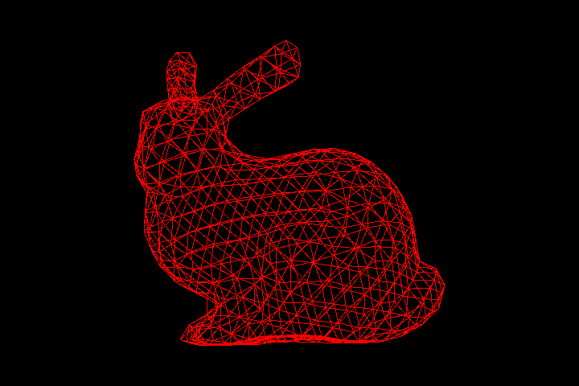
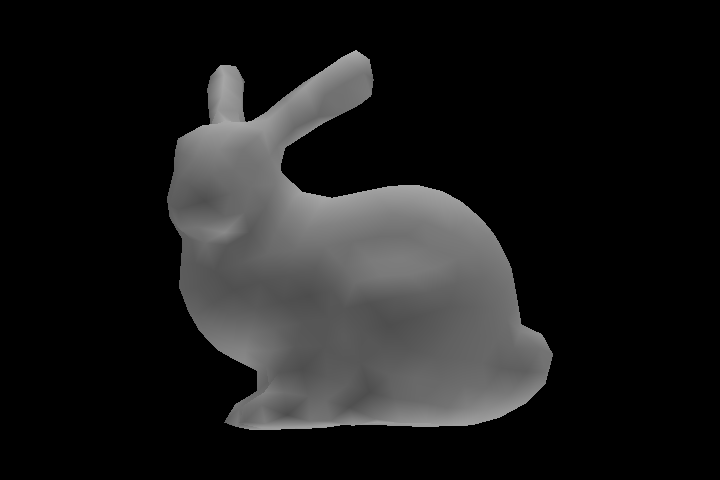
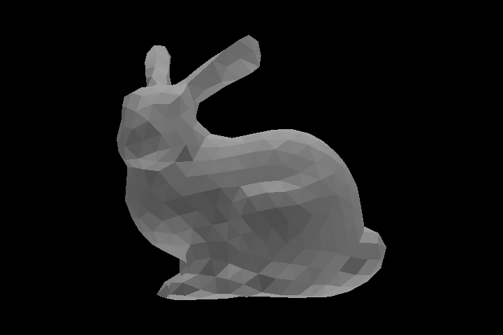
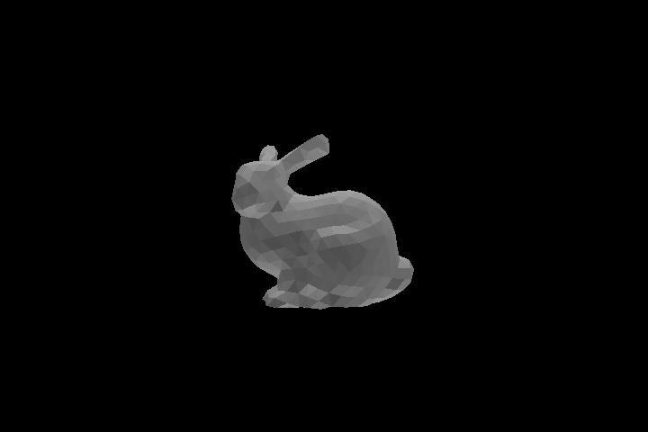

Rasterization Basics
===============

In this exercise, you will implement a rendering system for triangulated 3D models based on rasterization. Remember to **modify** `attributes.h` as necessary.

**Due: December 17, 10 am Pacific Time (PCT)**

### Using Eigen

In all exercises, you will need to do operations with vectors and matrices. To simplify the code, you will use [Eigen](http://eigen.tuxfamily.org/).
Have a look at the [Getting Started](http://eigen.tuxfamily.org/dox/GettingStarted.html) page of Eigen as well as the [Quick Reference](http://eigen.tuxfamily.org/dox/group__QuickRefPage.html}) page for a reference of the basic matrix operations supported.

### Preparing the Environment and Submission

Follow the instructions on the [general instructions page](../RULES.md) to set up what you need for the assignment.
For all exercises, all transformations **must** be applied in the shaders.

##### Setup

As in the previous assignments, this project needs the Eigen, stb, and gif-h libraries. Place them **next to** this assignment folder, not inside it:

```
your-workspace/
├── ext/
│   ├── eigen/       <- Eigen library goes here
│   ├── stb/         <- stb library goes here
│   └── gif-h/       <- gif-h library goes here
└── assignment5/     <- this repo
```

If CMake gives an error about missing headers, check that your folders are arranged this way.

### In-Class Demos

The small rasterizer demos shown in class are in `examples/extra/`. Each demo has a `main_<name>.cpp` and a matching `attributes_<name>.h`. The script `examples/build_demos.sh` builds each demo in its own folder and runs it once, so you can look at the output and read the code next to it. It does not modify any of the files in `examples/`.

Run it from the assignment folder:

```
bash examples/build_demos.sh              # build and run all demos
bash examples/build_demos.sh depth blend  # build and run only the listed demos
```

The results end up in `examples/demos/<name>/`:
- `main.cpp`, `attributes.h`, `raster.h`, `raster.cpp`: the demo's source code
- `demo`: the compiled program
- `triangle.png` (or `triangle.gif` for `animation`): the rendered output

| Demo | What it shows |
|---|---|
| `base` | Rasterizing a single triangle with a fixed color |
| `lines` | Rasterizing line segments |
| `attributes` | Interpolating per-vertex attributes (colors) across a triangle |
| `depth` | Using a depth test to resolve overlapping triangles |
| `view` | A view transformation that corrects for the framebuffer's aspect ratio |
| `blend` | Alpha blending of semi-transparent triangles |
| `projective` | A wireframe cube under a projective transformation |
| `supersample` | Anti-aliasing by rendering at a higher resolution and downsampling |
| `animation` | Rendering several frames and saving them as a GIF |

The script looks for Eigen in Homebrew (`/opt/homebrew/include/eigen3` or `/usr/local/include/eigen3`), then in `../ext/eigen`, then in `/usr/include/eigen3`. If it can't find Eigen or the other libraries, or you want to use a different compiler, set these variables:

```
EIGEN_DIR=/path/to/eigen3 EXT_DIR=/path/to/ext CXX=clang++ bash examples/build_demos.sh
```


Ex.1: Load and Render a 3D model [15pt]
------------------

The provided code rasterizes a triangle using the software rasterizer we studied in the class. Extend the provided code to load the same scenes used in Assignment 4, and render them using rasterization in a uniform color. At this stage, you should see a correct silhouette of the object rendered. The cameras should take into account the size of the framebuffer, properly adapting the aspect ratio to not distort the image whenever the framebuffer is resized. Remember that all transformations **must** be applied in the vertex shader. To check for correctness, we recommend to render a cube in wireframe mode.

1. Build the camera tranformation matrix
2. Build the Orthographic Projection matrix, see Assignment 3 for computing t and l.
3. Fill the shaders to rasterize the bunny in red

This is the expected output



Ex.2: [5pt]
----------------

Render the bunny using a wireframe; only the edges of the triangles are drawn.

This is the expected output




Ex.3: Shading [15pt]
-------------

In this exercise, you will implement two different shading options for the triangles: flat shading, and per vertex shading. The scene should always contain at least one light source, set as a shader uniform. Both flat shading and per-vertex shading should use the same code in the shader program. The only difference lies in the attributes that are sent to the vertex shader. You can reuse the code from the ray-tracing assignment for the lighting equation (you should implement both *diffuse* and *specular* shading components in the vertex, or fragment if you prefer, shader).

In **Flat Shading** each triangle is rendered using a unique normal (i.e. the normal of all the fragments that compose a triangle is simply the normal of the plane that contains it).

In **Per-Vertex Shading** the normals are specified on the vertices of the mesh, the color is computed for each vertex, and then interpolated in the interior of the triangle.

1. Implement the light equation
2. Implement the depth check
3. Compute the per face normals and render the bunny with flat shading
4. Compute the per vertex normals and render the bunny with vertex shading


Note that to perform flat shading, you will need to send per-face normal attributes to the shader program. However, with the provided rasterizer and for most modern APIs, it is only possible to send *per-vertex* attributes. One simple way to go around this limitation is simply to duplicate the input vertices for every triangle in the mesh. That is, from a pair **(V, F)** describing the mesh coordinates and triangles, build a new pair **(V', F')**, where every vertex from **V'** appears only once in **F'**.

To compute the per-vertex normals you should first compute the per-face normals, and then average them on the neighboring vertices. In other words, the normal of the vertex of a mesh should be the average of the normals of the faces touching it. Remember to normalize the normals after averaging.

This is the expected for flat shading


This is the expected for vertex shading




Ex.3: Object Transformation [10pt]
----------------------------------

Add an option to rotate the object around the y-axis centered on its barycenter, all transformations **must** be applied in the shaders. Produce 3 gif videos, one for each rendering type used above (i.e., wireframe, flat, and vertex).

This is the expected animation for flat shading




Ex.4: Camera [5pt]
-------------------------------

Implement a *perspective camera*. Note that for the shading to be correct, the lighting equation need to be computed in the camera space (sometimes called the *eye space*). This is because in the camera space the position of the camera center is known (it is (0,0,0)), but in the canonical viewing volume normals can be distorted by the perspective projection, so shading will be computed incorrectly.


This is the expected for flat shading and perspective camera



This is the expected for vertex shading and perspective camera


Deliverables
-------------

Submit your `main.cpp`, the `attribues.h` the final rasterized images and videos in a zip file.
